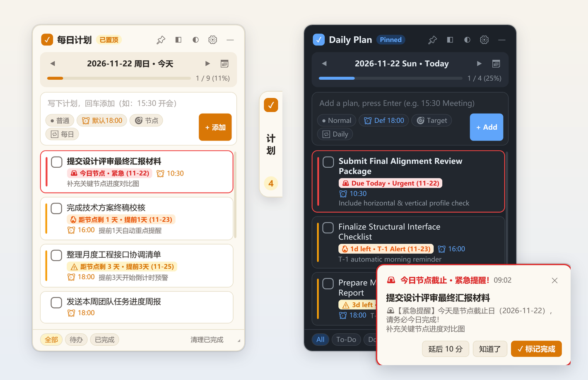
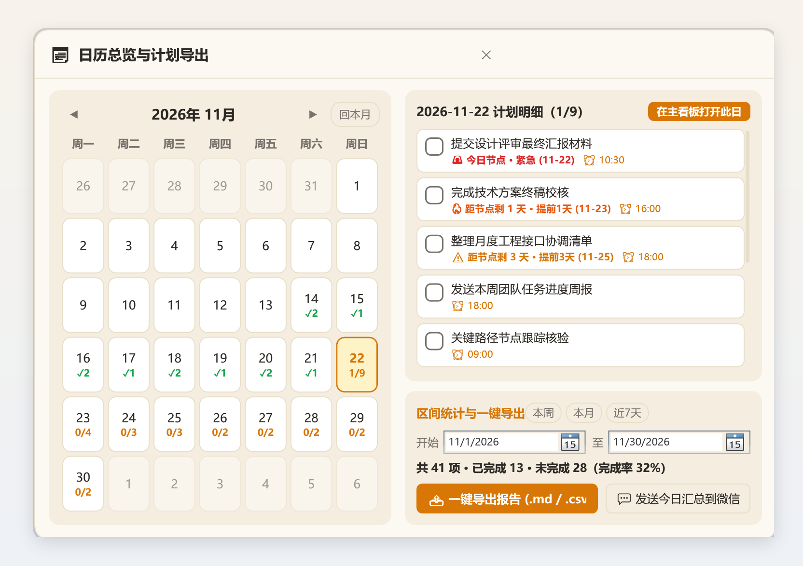
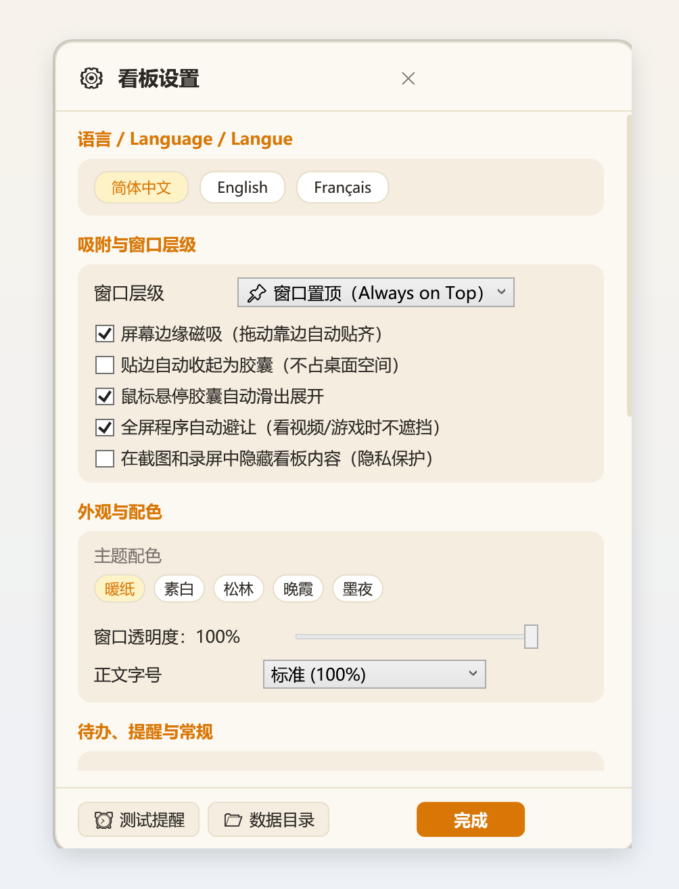

# DailyPlanBoard · 每日计划看板

<p align="center">
  <a href="./README.md">简体中文</a> · <strong>English</strong>
</p>

<p align="center">
  <strong>A lightweight native Windows desktop daily planner & milestone countdown widget</strong><br>
  Built with C# / WPF (.NET 7+) · &lt; 500 KB single executable · Ultra-low memory footprint · Edge-docked capsule
</p>

<p align="center">
  
</p>

---

## Screenshots

| Calendar Overview & Range Export | Settings & Customization |
| :---: | :---: |
|  |  |

---

## Key Features

### 1. Lightweight & Native Performance
* **Tiny Footprint**: Pure C# / WPF with zero heavy web wrappers (no Electron / WebView2). The framework-dependent single-file `.exe` is ~**460 KB**.
* **Low Memory Usage**: Software rendering mode plus idle working-set trimming keeps background memory around **10–20 MB**.
* **Local-First Privacy**: Plans and settings are stored strictly locally in a `data/` JSON folder alongside the executable (with automatic `.backup.json` backups)—no telemetry or cloud sync.

### 2. Multi-Day Milestone Scheduling & 3-Stage Urgent Alerts
* **Quick Milestone Assignment**:
  * Inline syntax right inside the quick-add box (e.g., `Submit design report @11-28`, `Node:2026-12-05`);
  * Or click the `🎯` Milestone button for presets (`+3d` / `+5d` / `+1w` / `+2w` / `Month-end` / custom calendar picker).
* **Automatic Multi-Day Population**: When a milestone date is set, the task is automatically scheduled across **every day from the start date through the milestone deadline**, linked under a shared `MilestoneGroupId`.
* **Dynamic Countdown Badges**: Each daily card displays its live days-remaining badge:
  * **Due Today (T-0)**: `🚨 Due Today · Urgent` (red-highlighted border & automatic Urgent priority escalation)
  * **1 Day Left (T-1)**: `🔥 1d left · T-1 Alert`
  * **3 Days Left (T-3)**: `⚠️ 3d left · T-3 Alert`
  * **Earlier Days**: `⏳ Xd left`
* **Escalating Alerts**: Automated reminders fire at **T-3**, **T-1**, and **T-0**; on milestone day, it triggers an urgent red popup card, urgent Windows alert sound, tray warning balloon, and optional WeCom Bot alert.
* **Series Batch Actions**: Right-click any linked card to mark the entire milestone series complete or delete the whole series at once.

### 3. Screen-Edge Docking Capsule & Self-Healing TopMost
* **Edge Snapping & Auto-Collapse**: Drag near the left/right monitor edge to snap automatically, or press `Ctrl + W` (`◧`) to collapse into a sleek edge capsule showing today's pending count. Moving the mouse out of an expanded docked board collapses it smoothly (~180ms).
* **Hover Peek & Pin Expand**: Hover over the edge capsule to peek and check off tasks; click to pin open; drag vertically to adjust height or horizontally across the screen center to switch sides.
* **8-Direction Resizing**: Resize freely from any edge or corner when expanded; auto-collapse pauses during resize and dimensions are persisted.
* **Self-Healing Z-Order & Smart Fullscreen Avoidance**: Periodically checks `WS_EX_TOPMOST` and overlapping third-party windows (`GW_HWNDPREV`) without stealing focus (`SWP_NOACTIVATE`) or covering Start Menu / IME / context menus. Distinguishes genuine fullscreen apps (games, fullscreen video, F11 browsers, PowerPoint slideshow) from normal maximized windows or Windows Shell overlays, and recalibrates automatically on `DisplaySettingsChanged`.

### 4. Default Reminders, Next-Day Rollover & Multi-Channel Alerts
* **Configurable Default Reminders**: Optional default reminder time for new tasks (default `18:00`), overridable inline (e.g., `15:30 Team Sync`) or via quick presets.
* **Auto-Rollover**: Unfinished tasks automatically roll over to the next day with an optional morning reminder (default `09:00`).
* **Multi-Channel Notifications**: Interactive always-on-top reminder card (Complete / Snooze 10m / 30m / 1h) + system alert sound + Windows tray balloon + **WeCom (Enterprise WeChat) Group Bot Webhook** push.

### 5. Calendar Overview, Range Export & Trilingual UI
* **Calendar Overview (`📅` / `Ctrl + M`)**: Inspect daily completion badges and milestone countdowns across any month and jump directly to any date.
* **One-Click Report Export**: Pick any date range (or preset: This Week / This Month / Last 7 Days) and export completion statistics + task details as **Markdown (`.md`)** or **CSV (`.csv`)**, or send today's summary directly to WeCom.
* **Trilingual UI & Visual Customization**: Instant switching between **简体中文 / English / Français**; 5 curated themes (`Warm Paper`, `Clean Light`, `Forest`, `Sunset`, `Dark Slate`), opacity slider, font scaling, and **Exclude from Screen Capture** privacy mode.

---

## Keyboard Shortcuts

| Shortcut | Scope | Action |
| :--- | :--- | :--- |
| `Alt + Q` (customizable) | Global | Show / Collapse board |
| `Ctrl + W` | In-app | Collapse to screen-edge capsule |
| `Ctrl + N` / `Ctrl + K` | In-app | Focus quick-add input |
| `Ctrl + M` | In-app | Open Calendar Overview & Export |
| `Ctrl + P` | In-app | Cycle window mode (TopMost / Desktop / Normal) |
| `Ctrl + T` | In-app | Cycle color theme |
| `Ctrl + L` | In-app | Cycle UI language (ZH / EN / FR) |
| `Alt + ←` / `Alt + →` | In-app | Previous / Next day |
| `Ctrl + Home` | In-app | Jump to Today |

---

## Build from Source

### Prerequisites
* Windows 10 / 11 (x64)
* [.NET 7+ Desktop Runtime (x64)](https://dotnet.microsoft.com/download/dotnet) to run framework-dependent builds
* **.NET 7.0 SDK** or later to compile from source (`<RollForward>Major</RollForward>` enabled)

```powershell
# Clone repository
git clone https://github.com/bobbychensiyu-sketch/DailyPlanBoard.git
cd DailyPlanBoard

# Build Release
dotnet build .\src\DailyPlanBoard.csproj -c Release

# Publish single-file executable (framework-dependent)
dotnet publish .\src\DailyPlanBoard.csproj -c Release -r win-x64 --self-contained false -p:PublishSingleFile=true -o .\publish
```

> Pass `--self-contained true` if you want a standalone executable bundled with the .NET runtime.

---

## Project Structure

```text
DailyPlanBoard/
├── src/
│   ├── Assets/                 # Application icon
│   ├── Helpers/                # Procedural tray/window icon generator
│   ├── Models/                 # PlanItem, Milestone countdown & AppSettings models
│   ├── Services/               # JSON storage, trilingual L10n, scheduler, Win32 helpers, WeCom notifier
│   ├── Views/                  # MainWindow, EdgeCapsule, CalendarOverview, EditTask, ReminderPopup, Settings
│   ├── App.xaml(.cs)
│   └── DailyPlanBoard.csproj
├── .gitignore
├── LICENSE
├── README.md
└── README.en.md
```

---

## Acknowledgements & License

* Inspired in its warm-paper aesthetic and edge-docked capsule UX by the open-source project [PaperTodo](https://github.com/snownico0722/PaperTodo).
* Released under the [MIT License](./LICENSE).
